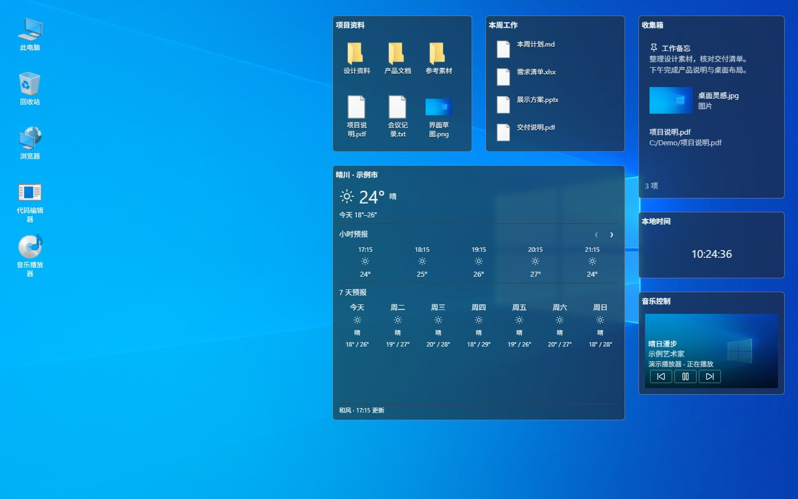
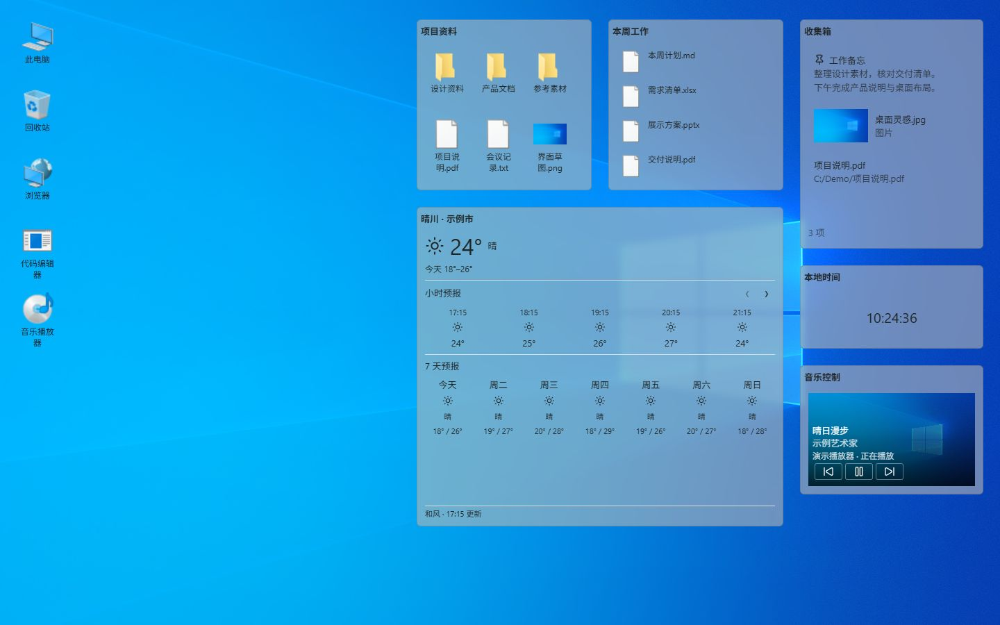

# Desktop Tools

Desktop Tools 是一款面向个人效率用户、专业创作者和开发者的 Windows 桌面内容工作区。它把文件、文件夹、围栏、门户和信息组件放在同一个可恢复的桌面表面上，同时保留 Windows Explorer 的文件事实、Shell 操作和系统恢复能力。

## 软件截图



<details>
<summary>浅色桌面工作区</summary>



</details>

## 功能

- **桌面工作区**：组织文件、目录、快捷方式和功能格子，支持移动、缩放、折叠、边缘吸附、布局恢复和多显示器显示。
- **围栏与文件夹门户**：围栏负责项目归属、排序和滚动；文件夹门户负责浏览绑定目录及其子目录，并支持真实文件拖入和拖出。
- **Shell 内容呈现**：按需读取 Windows Shell 缩略图、视频帧和音频封面；加载失败时保留系统图标，不添加音乐角标、视频边框或快捷方式箭头。
- **收集箱**：集中保存文本、独立图片和普通文件映射。支持 Markdown 编辑、图片预览、类型筛选、多选、拖出和共享内容；删除收集记录不会删除文件映射指向的源文件。
- **功能格子**：提供收集箱、音乐、时间、Debug 和天气等官方组件。组件沿用统一的标题、菜单、移动、尺寸和跨屏交互。
- **天气**：支持当前天气、24 小时预报和包含今天的 7 天预报；可搜索并保存当前城市，城市搜索结果不保存。天气格子按照实时尺寸显示摘要、小时、日或完整预报；右键“固定显示模式”可锁定当前模式并限制最小尺寸，“切换显示模式”可选择其他模式，取消固定后恢复自动适配。来源栏显示“和风 · 时间 更新”，详情通过标题栏右上角按钮或右键菜单打开，凭据由用户在设置中配置。
- **编辑与系统操作**：Markdown 编辑窗保留原始文件引用；打开网页、邮件、文件和媒体时使用系统默认程序。文件打开、重命名、复制、移动和删除通过 Windows Shell 执行。

## 构建与运行

### 环境

- Windows 10/11 x64
- Node.js 与 npm
- Rust stable，以及项目配置所需的 Cargo 工具链
- Tauri 所需的 Windows WebView2 和 C++ 构建工具

### 安装依赖

```text
npm install
```

### 开发运行

```text
npm run dev
```

### 检查与构建

```text
npm run typecheck
npm run test:frontend
npm run test:rust
npm run build
npm run tauri:build
```

`npm run build` 生成前端发布资源；`npm run tauri:build` 生成 Windows 应用构建产物。未签名的 Windows x64 测试安装包可通过 `npm run tauri:installer` 生成，NSIS 产物位于 `build/target/release/bundle/nsis/`。

## 使用说明

首次打开后，可以从桌面背景菜单或设置入口添加功能格子。拖动文件或文件夹可将内容交给门户或收集箱；双击、Enter 或格子菜单可打开对应内容。工作区状态会保存，重新启动后恢复已保存的布局和组件设置。

天气功能默认关闭。启用后，在“功能格子 → 天气”中填写和风天气 JWT 所需的 API Host、开发者 ID、项目 ID、凭据 ID 和 Ed25519 私钥，完成城市搜索与能力验证后保存。天气格子只保存当前选中的城市，用于下次启动恢复天气；没有城市时显示“未选择城市或地区”。

## 功能边界

- Desktop Tools 维护工作区布局、围栏归属、门户配置和功能格子状态；Windows Explorer 继续维护文件事实和 Shell 恢复能力。
- 天气使用用户自己的和风天气账户，不内置共享凭据；真实账户权限、网络可用性和供应商配额由用户账户决定。
- 天气缓存用于减少重复请求，数据可能因网络、有效期或服务端限制而暂时不可用；天气页面显示来源、更新时间和失败状态。
- 多显示器、混合 DPI、Windows 外部拖放和持续拖动性能需要在 Windows 宿主上验证，自动化测试不能替代真实设备检查。
