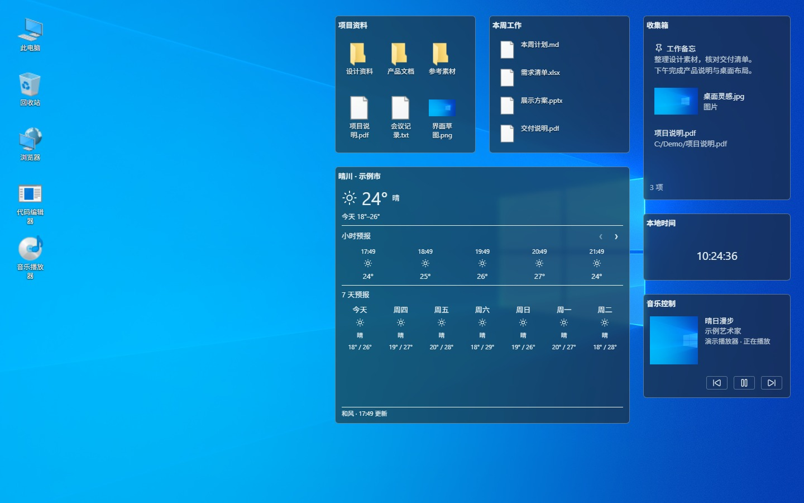
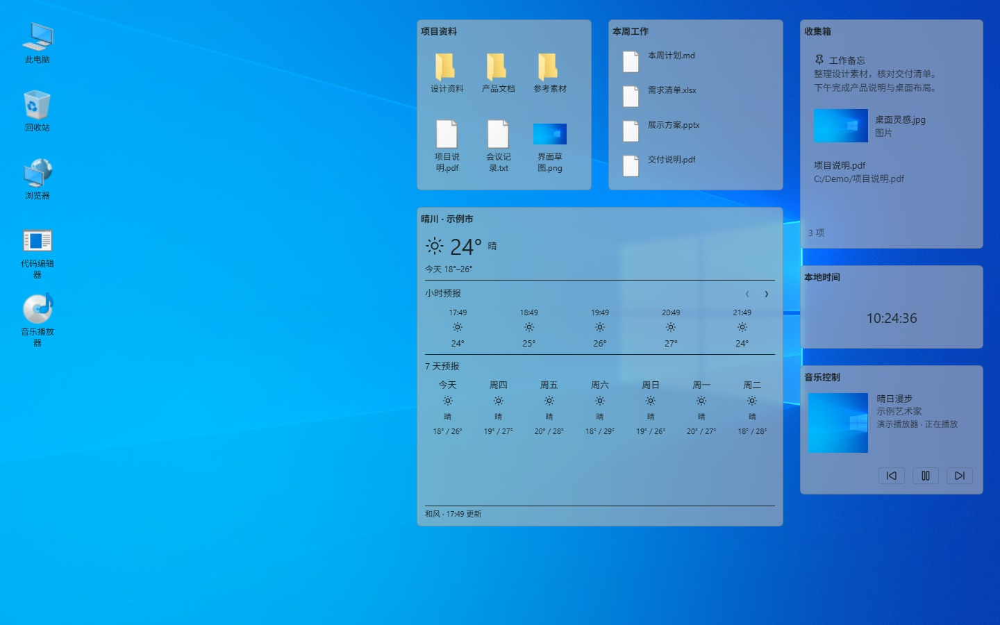

# 🖥️ Desktop Tools

Desktop Tools 是一款 Windows 桌面内容工作区。它把桌面文件、文件夹、围栏、文件夹门户和常用信息组件放在同一个可恢复的桌面上，同时继续使用 Windows Explorer 管理文件。



<details>
<summary>浅色主题</summary>



</details>

> 截图为演示数据，不包含真实文件、账户或天气凭据。

## ✨ 功能

- **桌面工作区**：整理桌面项目，支持移动、缩放、折叠、边缘吸附、布局恢复和多显示器。
- **围栏与文件夹门户**：把项目分组到围栏；文件夹门户可以浏览绑定目录并接收真实文件拖入、拖出。
- **收集箱**：集中保存文本、图片和文件映射，支持 Markdown 编辑、预览、筛选、多选和拖出；删除收集记录不会删除源文件。
- **功能格子**：天气、音乐、时间等桌面组件。天气支持多家来源、24 小时和 7 天预报；音乐格子可显示播放信息和歌词。
- **主题与插件**：用主题插件整体更换配色、字体和圆角；用插件扩展桌面格子与设置页条目。插件需要声明能力，涉及本机数据的调用由宿主按实例授权。
- **Windows 集成**：使用系统缩略图、系统默认程序打开内容，并通过 Windows Shell 完成重命名、复制、移动和删除。

## 🚀 快速开始

环境要求：

- Windows 10/11 x64
- Node.js 与 npm
- Rust stable 与 Cargo
- Tauri 所需的 WebView2 和 C++ 构建工具

安装依赖并启动开发版：

```text
npm install
npm run tauri:dev
```

开发版启动前请先退出已安装的 Desktop Tools，否则会因桌面菜单互斥体被占用而直接退出。

常用命令：

```text
npm run typecheck      # 类型检查
npm test               # 前端、组件与 Rust 测试
npm run tauri:build    # 构建 Windows 应用
npm run tauri:installer # 生成未签名 NSIS 安装包
```

安装包输出在 `build/target/release/bundle/nsis/`。安装时可选择仅当前用户或所有用户。

## 📖 使用方式

1. 从桌面背景菜单或设置页添加功能格子，可以添加天气、音乐、时间等组件。
2. 拖动文件或文件夹，可以把内容交给文件夹门户或收集箱。
3. 双击、Enter 或格子菜单可以打开对应内容；布局和组件状态会自动保存，下次启动恢复。

## 🚧 功能边界

- 仅支持 Windows 10/11 x64。
- Desktop Tools 负责工作区布局、围栏归属、门户配置和功能格子状态；文件事实与 Shell 恢复仍由 Windows Explorer 负责。
- 天气使用你自己的和风天气或 Foreca 账户，不内置共享凭据；网络和供应商配额由你的账户决定。
- 插件是本地 JavaScript 模块，请只安装可信来源的插件。
- 截图使用演示数据；真实文件拖放、多显示器、混合 DPI 和透明桌面合成需要在 Windows 实机上验证。

## 📄 许可

核心应用采用 GPL-3.0-or-later，完整许可见 `resources/许可证/`。界面图标取自 [Lucide](https://lucide.dev/icons/)，主题字体与第三方资源许可随资源一并提供。

项目源码：https://github.com/TIAmo1208/DesktopTools
